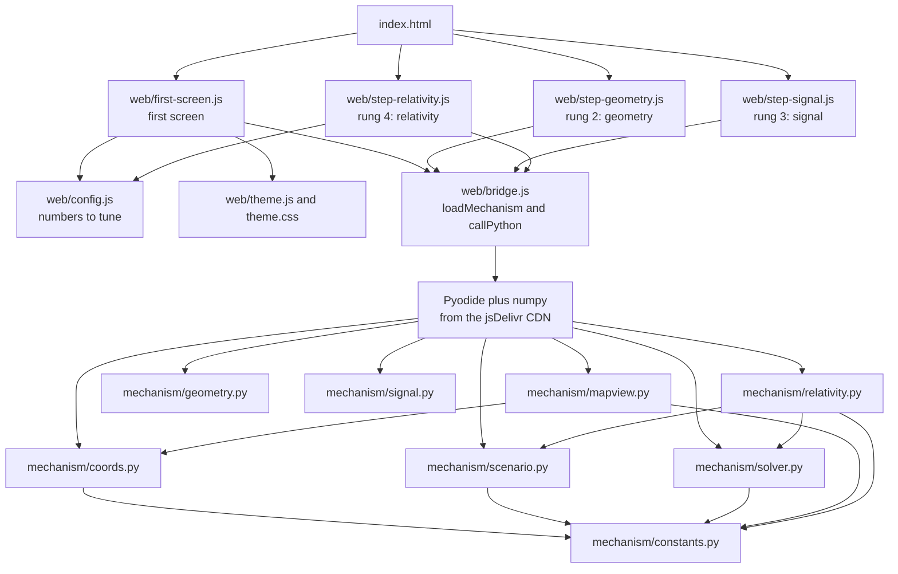

# Architecture

## The two halves

- **Python side** (`mechanism/`): all the GPS maths. Pure functions that take plain numbers, lists and dicts and return the same.
- **JavaScript side** (`index.html`, `web/`): draws the page, reads sliders and buttons, and calls Python. The comment at the top of [web/first-screen.js](../../web/first-screen.js) says the only arithmetic there is `Math.hypot` for the position error and the map's metres-to-pixels scaling.
- **Between them**: [web/bridge.js](../../web/bridge.js) loads Pyodide (Python compiled to run in a browser) and gives the page one function, `callPython`.

## How the pieces connect

Notes on the diagram, each checked in the code:

- `index.html` loads `web/first-screen.js` with `<script type="module" src=...>`, and a second inline module imports `mountGeometryStep`, `mountSignalStep` and `mountRelativityStep`.
- `first-screen.js` reaches the bridge with a dynamic `import("./bridge.js")` inside `try/catch`, so the page still paints if the bridge fails. The step files do the same. They share one module instance, so Pyodide loads once (`loadMechanism` memoises its promise).
- `step-geometry.js` has its own `geometryConfig` and does not import `config.js`. `first-screen.js` and `step-relativity.js` import `config.js`.
- `mapview.py` imports the private `_local_directions` from `coords.py` (gotchas.md, 2026-11-23: renaming it breaks `mapview`).
- `geometry.py` and `signal.py` import no other mechanism module.
- Which module a call goes to is chosen by the string you pass to `callPython`, for example `"solver.solve_position"`. `bridge.js` imports `mechanism.<module>` at call time (`importlib.import_module`), so there is no direct JavaScript-to-Python import edge. The arrows from Pyodide to each module stand for that.

## What crosses the Python / JavaScript line

The contract is [docs/interface.md](../interface.md). The rules in it:

- Only plain numbers, strings, booleans, lists and dicts cross. No numpy arrays, no custom classes.
- Units are in the name: `_m` metres, `_s` seconds, `_deg` degrees.
- A point is `{"x_m", "y_m", "z_m"}`, metres from the Earth's centre. A satellite is a point plus an `"id"` string.
- On bad input a function returns `{"error": "<plain message>"}` instead of raising. The page shows that sentence.

How it is done in the code ([web/bridge.js](../../web/bridge.js)): the page sends the arguments as JSON text (`JSON.stringify(args)`). The Python helper `_bridge_call` reads them with `json.loads`, calls the function, and sends back `json.dumps(result)`, which the page reads with `JSON.parse`. That is why no numpy arrays can cross, and why `signal.correlate` returns `1e9` instead of infinity (a comment in `signal.py` says infinity is not valid JSON).

| Python function | The page sends | Python sends back |
|---|---|---|
| `coords.latlon_to_xyz(lat_deg, lon_deg, height_m=0)` | two numbers | a point |
| `coords.satellite_from_sky(receiver_lat_deg, receiver_lon_deg, azimuth_deg, elevation_deg)` | four numbers | a point |
| `scenario.make_pseudoranges(receiver, satellites, clock_error_s, noise_m=0, seed=0)` | a point, a list of satellites, numbers | a list of numbers, one per satellite |
| `solver.solve_position(satellites, pseudoranges_m, solve_clock=True)` | satellites, a list of numbers, a boolean | `{"x_m","y_m","z_m","clock_error_s","steps","converged"}`; `steps` is a list of guesses |
| `mapview.to_local(receiver_lat_deg, receiver_lon_deg, point)` | two numbers, a point | `{"east_m","north_m","up_m"}` |
| `mapview.distance_lines(...)` | lat, lon, satellites, pseudoranges, assumed clock error, half width, samples | a list, one per satellite: `{"id","points":[[east_m,north_m],...],"inside"}` |
| `geometry.dop(receiver, satellites)` | a point, satellites | `{"gdop","pdop","tdop"}` |
| `signal.ca_code(prn)` | an integer 1 to 32 | a list of 1023 values, +1 or -1 |
| `signal.make_received(prn, delay_chips, noise_std, seed=0)` | integers and a number | a list of 1023 numbers |
| `signal.correlate(received, prn)` | a list of 1023 numbers, an integer | `{"scores","best_delay_chips","peak_to_next"}` |
| `relativity.drift_over_time(receiver, satellites, phone_clock_error_s, hours_list)` | a point, satellites, a number, a list of hours | a list, one dict per hour: `hours`, `range_added_m`, `error_clock_solved_m`, `error_clock_trusted_m`, `solved_clock_error_s` |

Where the sources disagree: `docs/interface.md` has no row for `relativity.drift_over_time`. decisions.md (2026-11-23, `mechanism/relativity.py`) says the proposed row is in the pull request text, not in interface.md. The last line of interface.md also still says later rungs "add" `signal.py` and `relativity.py`, which exist now. The table row for `drift_over_time` above comes from reading `mechanism/relativity.py`, not from the contract.

## Every folder and tracked file

Taken from `git ls-files` on this branch.

### Root

- [index.html](../../index.html): the one page: first screen, then three step sections mounted below it.
- [README.md](../../README.md): public project description and what is simplified.
- [AGENTS.md](../../AGENTS.md): the one instruction file all AI agents read. [CLAUDE.md](../../CLAUDE.md) only imports it.
- [CONTRIBUTING.md](../../CONTRIBUTING.md): how the four teammates work with issues and pull requests.
- [LICENSE](../../LICENSE): MIT licence.
- [pytest.ini](../../pytest.ini): test config (`pythonpath = .`, `testpaths = tests`).
- [requirements-dev.txt](../../requirements-dev.txt): `pytest` and `numpy`.
- [.gitattributes](../../.gitattributes), [.gitignore](../../.gitignore), [.nojekyll](../../.nojekyll): git settings; `.nojekyll` tells GitHub Pages not to run Jekyll.

### mechanism/ (Python, the maths)

- [\_\_init\_\_.py](../../mechanism/__init__.py): empty; makes `mechanism` a package.
- [constants.py](../../mechanism/constants.py): speed of light, Earth radius, GPS orbit radius, relativity drift per day.
- [coords.py](../../mechanism/coords.py): latitude/longitude to x,y,z; x,y,z back; sky direction to satellite position; local east/north/up directions.
- [scenario.py](../../mechanism/scenario.py): `make_pseudoranges`, the distances a phone would measure.
- [solver.py](../../mechanism/solver.py): `solve_position`, finds position (and optionally the clock).
- [mapview.py](../../mechanism/mapview.py): turns positions and distances into local east/north numbers and the distance lines for the map.
- [geometry.py](../../mechanism/geometry.py): `dop`, how satellite layout multiplies errors.
- [signal.py](../../mechanism/signal.py): the C/A code, a noisy received copy, and the correlator.
- [relativity.py](../../mechanism/relativity.py): `drift_over_time`, adds a shared clock drift and solves two ways.

### web/ (JavaScript, CSS, test pages)

- [bridge.js](../../web/bridge.js): loads Pyodide and the mechanism files; exports `loadMechanism`, `callPython`, and `evalPython` (debug helper for the test page).
- [config.js](../../web/config.js): placeholder numbers for the first screen and rung 4: receiver, satellites, map size, slider range, error limits, relativity hours.
- [first-screen.js](../../web/first-screen.js): the first screen: map, clock slider, solve button, satellite switches.
- [step-geometry.js](../../web/step-geometry.js): rung 2, the "Bunch the satellites" slider and DOP readout.
- [step-signal.js](../../web/step-signal.js): rung 3, the "Add noise" slider and the correlation graphs.
- [step-relativity.js](../../web/step-relativity.js): rung 4, the drift-over-time table.
- [theme.css](../../web/theme.css), [theme.js](../../web/theme.js): the Instrument look (colours, fonts, spacing) and two helpers (pointer light, light/dark switch).
- [theme-preview.html](../../web/theme-preview.html): a page that previews the theme alone.
- [bridge-test.html](../../web/bridge-test.html): a page that tests the bridge alone.
- [dev/step-geometry.html](../../web/dev/step-geometry.html), [dev/step-signal.html](../../web/dev/step-signal.html): mount one step alone for testing.

### tests/ (pytest)

- [test_coords.py](../../tests/test_coords.py), [test_geometry.py](../../tests/test_geometry.py), [test_mapview.py](../../tests/test_mapview.py), [test_relativity.py](../../tests/test_relativity.py), [test_scenario.py](../../tests/test_scenario.py), [test_signal.py](../../tests/test_signal.py), [test_solver.py](../../tests/test_solver.py): one test file per mechanism module.
- [test_smoke.py](../../tests/test_smoke.py): checks one microsecond is between 299 and 300 metres.

### docs/

- [interface.md](../interface.md): the contract between Python and the page.
- [facts.md](../facts.md): every number the page or documents use, with its source.
- [ui-guide.md](../ui-guide.md): layout, look and motion rules for the page.
- [project-page.md](../project-page.md): a draft of the project page text (marked "Draft for Icarus").
- [onboarding/](.): this folder.

### scripts/

- [check_relativity.py](../../scripts/check_relativity.py): shows what a clock drift shared by every satellite does to the position.
- [setup-github.sh](../../scripts/setup-github.sh), [create-issues-wave1.sh](../../scripts/create-issues-wave1.sh), [create-issues-wave2.sh](../../scripts/create-issues-wave2.sh): one-time GitHub setup, run by Icarus.

### .github/

- [workflows/tests.yml](../../.github/workflows/tests.yml): runs `python -m pytest -q` on Python 3.14 for every pull request and every push to `main`.
- [pull_request_template.md](../../.github/pull_request_template.md), [ISSUE_TEMPLATE/bug.md](../../.github/ISSUE_TEMPLATE/bug.md), [ISSUE_TEMPLATE/goal.md](../../.github/ISSUE_TEMPLATE/goal.md): the pull request and issue templates.

### .memory/

Team memory for the agents (spec in `design.md`, decisions, gotchas, commands, overview). Index: [.memory/INDEX.md](../../.memory/INDEX.md). Not covered line by line here.
